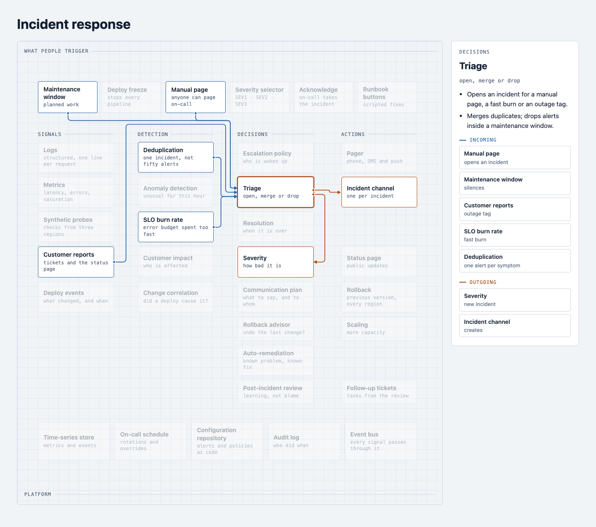

# Atlas

[](https://github.com/rpairo/atlas/actions/workflows/ci.yml)
[](LICENSE)

A dependency-free engine for relational maps. You describe nodes, lanes and connections in a small
JSON document; Atlas places every node, routes every wire and keeps the map stable while you edit
it. Plain HTML, CSS and JavaScript: no framework, no build step, and no network access of its own.

<picture>
  <source media="(prefers-color-scheme: dark)" srcset="docs/images/hero-dark.png">
  
</picture>

**[Live demo](https://rpairo.github.io/atlas/)** · [Getting started](docs/getting-started.md) ·
[Board format](docs/board-format.md) · [API](docs/api.md) · [Theming and layout](docs/theming-and-layout.md)

- **Placement that respects the author.** Declared lanes are never second-guessed. Constraints
  and the current order come before any optimisation, and relations only decide the order inside
  a lane.
- **Wires that never cross a node.** Orthogonal routing through free corridors, bundles that
  branch like a wiring diagram, crossings minimised by search.
- **Stable editing.** Adding a node never swaps two existing ones in a lane. Every edit is one
  undoable step, and undo restores the exact document.
- **Accessible and themable.** The DOM is the accessible version of the map, the keyboard reaches
  everything, `prefers-reduced-motion` is honoured and every colour is a CSS variable.

## Install

Atlas is two single files with everything inside, styles included. Pick one way:

| How | What to use |
|---|---|
| Download | `atlas.js` (ES module) or `atlas.global.js` (classic script) from the [latest release](https://github.com/rpairo/atlas/releases/latest) |
| CDN | `https://cdn.jsdelivr.net/gh/rpairo/atlas@v0.5.0/dist/atlas.js` (always with an exact version) |
| npm, from GitHub | `npm install github:rpairo/atlas#v0.5.0`, then `import { Atlas } from "@rpairo/atlas"` |
| Copy | `dist/atlas.js` or `dist/atlas.global.js` from this repository |

Atlas is not published to the npm registry. Every release lists the
[Subresource Integrity](https://developer.mozilla.org/docs/Web/Security/Subresource_Integrity)
hashes of its files; [Getting started](docs/getting-started.md#pin-a-version) shows how to use them.

## Quick start

```html
<script type="module" src="https://cdn.jsdelivr.net/gh/rpairo/atlas@v0.5.0/dist/atlas.js"></script>

<atlas-map>
  <script type="application/json">
    {
      "lanes": [{ "id": "in", "title": "Inputs" }, { "id": "out", "title": "Outputs" }],
      "nodes": [
        { "id": "form", "title": "Sign-up form", "lane": "in" },
        { "id": "mail", "title": "Welcome email", "lane": "out" },
        { "id": "crm", "title": "CRM record", "lane": "out" }
      ],
      "edges": [
        { "from": "form", "to": "mail", "label": "sends" },
        { "from": "form", "to": "crm", "label": "creates" }
      ]
    }
  </script>
</atlas-map>
```

Click a node to see its wires and its detail. From JavaScript:

```js
import { Atlas } from "./atlas.js";

const map = new Atlas(document.querySelector("#map")).load(board);
map.addEventListener("change", () => save(map.toJSON()));       // reloads exactly as it is
map.addNode({ id: "sms", title: "Welcome SMS", lane: "out" })    // goes to the best gap
  .addEdge({ from: "form", to: "sms", label: "sends" });
map.undo();
```

Checking and editing boards needs no browser; these run in Node too:

```js
import { validate, apply } from "@rpairo/atlas";
const { ok, errors, warnings } = validate(text);                 // never throws
const saved = apply(text, [{ op: "removeNode", id: "crm" }]);    // the board to save
```

## Documentation

| Page | What it covers |
|---|---|
| [Getting started](docs/getting-started.md) | Every way to load Atlas, a first map step by step, saving, pinning a version |
| [Board format](docs/board-format.md) | The `atlas/1` document: lanes, bands, nodes, edges, groups, constraints, limits, errors |
| [JavaScript API](docs/api.md) | `Atlas`, `<atlas-map>`, events, the pure functions, and what SemVer covers |
| [Theming and layout](docs/theming-and-layout.md) | CSS variables, dark mode, parts, directions, the panel and the stacked mode |
| [Accessibility](docs/accessibility.md) | Keyboard, screen readers, motion |
| [Security](docs/security.md) | Untrusted boards, limits, Content Security Policy |
| [Design](docs/design.md) | How placement, routing and animation work, and the research behind them |
| [Examples](examples/README.md) | Four boards and a copy-paste starter page |

TypeScript declarations ship in `types/atlas.d.ts`.

## Browser support

Atlas needs Custom Elements v1, Shadow DOM, CSS subgrid, container queries, `ResizeObserver`,
`replaceChildren()`, the Web Animations API and SVG `getTotalLength()`. From the support tables that
means Chrome and Edge 117+, Firefox 110+ and Safari 16+.

**What is tested:** every pull request runs the browser audit (every node selected, every wire
checked, edits, keyboard, accessibility and layout invariants, at several widths, in every
direction, right to left and in a short window) in headless Chrome, and the same audit in Firefox
and WebKit (Safari's engine) through Playwright. Real Safari, older versions and mobile browsers on
a device have not been tested; reports are welcome.

## Contributing

Bug reports and pull requests are welcome; see [CONTRIBUTING.md](CONTRIBUTING.md) for the
development setup, the tests and the browser audit. Security issues: [SECURITY.md](SECURITY.md).

## License

[MIT](LICENSE) © Raúl Pera Pairó
